## Evidence

Steps: Start the desktop app with two projects from each of two synthetic folders (`northwind/api`, `northwind/storefront`, `hobby/pixel-dungeon`, `hobby/synth-plugin`), one replayed thread each. Filter the main window to `api` and `storefront`. Search the command palette for `window` and `mini mode`. Open **New Window** and filter it to `pixel-dungeon` and `synth-plugin`. Close that window with its native close button and save it as `Hobby`. Open **Settings → General**, reopen `Hobby`, and load a local page in its browser panel. Enter Mini Mode from the main window, then expand. On base, repeat each step as far as it goes, then close the only window with its native close button.

Environment for every capture: Linux (WSL2), Electron desktop dev build (`vp run dev:desktop`) on a 1280×800 Xvfb screen, light theme, fresh synthetic data (isolated `--home-dir` and Electron profile), replay provider, real X input (XTEST) for clicks, keys and the native close button.

Proven: base has no second window, window palette entries, Windows settings, save prompt, Mini Mode, or per-window preview. Head has all six. The saved `Hobby` profile kept its two-project filter and bounds, and reopened with them.

| Capture | Before — [7d32075e37](https://github.com/pingdotgg/t3code/commit/7d32075e3757ded707914e2450c3e392a9665765) | After — [636249f975](https://github.com/Na0s/t3code/commit/636249f975a67a408f2b03a4f5dbfc6ba1530339) |
| --- | --- | --- |
| Separate project filters | 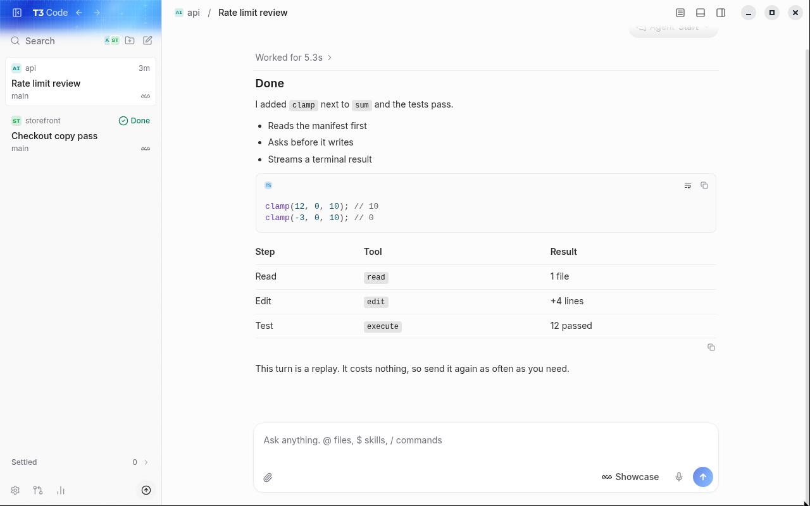 | 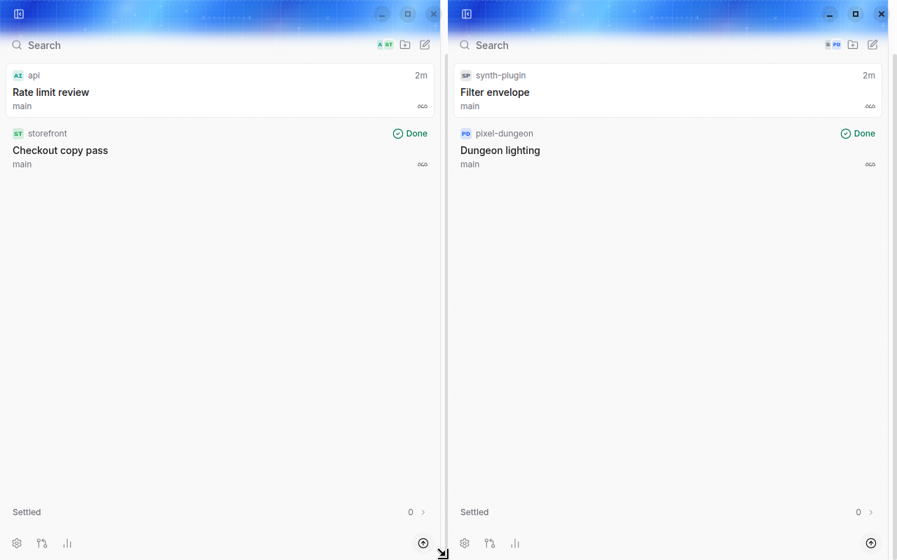 |
| Command palette, `window` | 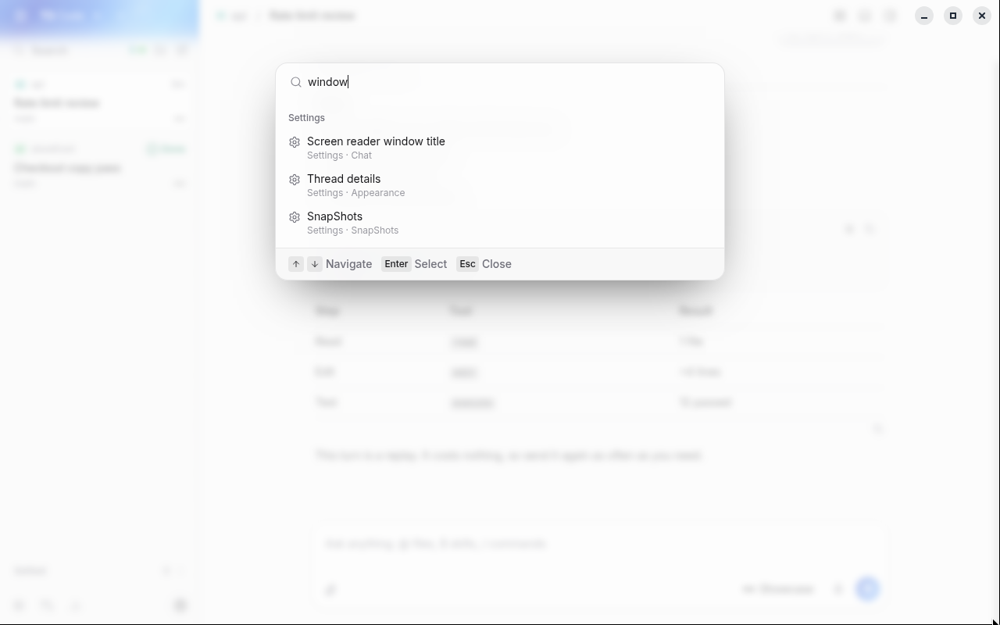 | 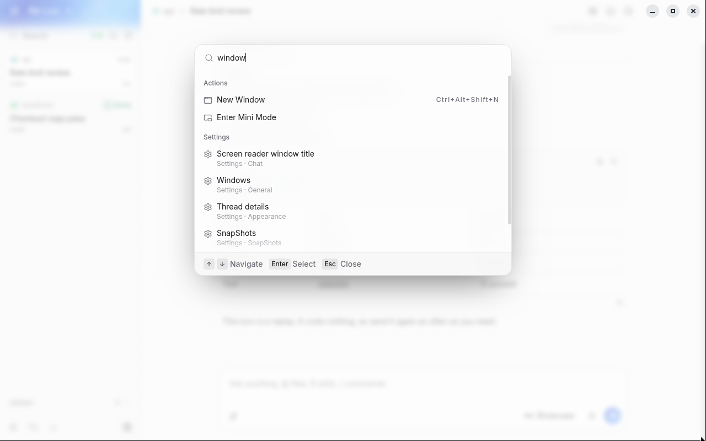 |
| Settings → General | 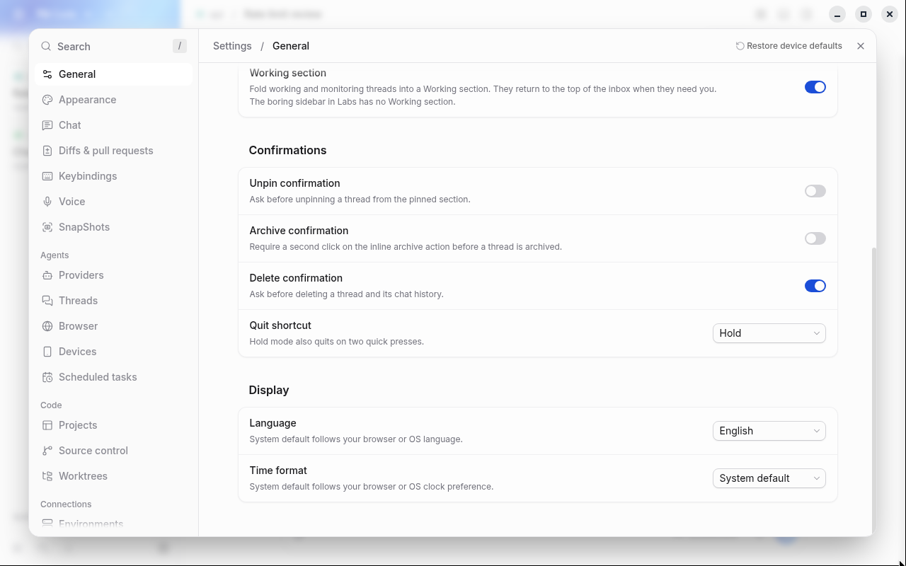 | 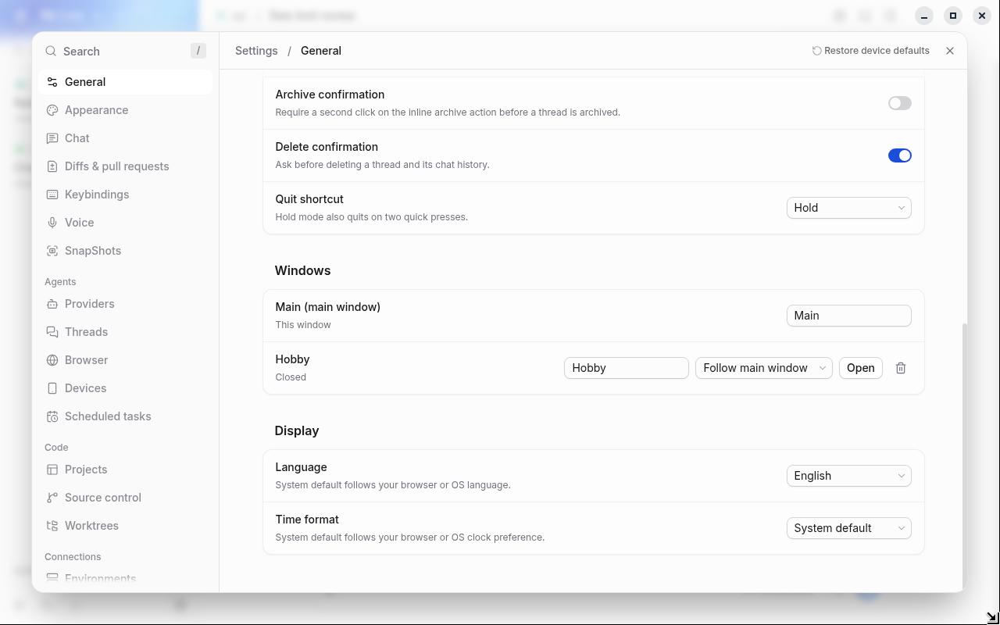 |
| Native close button |  | 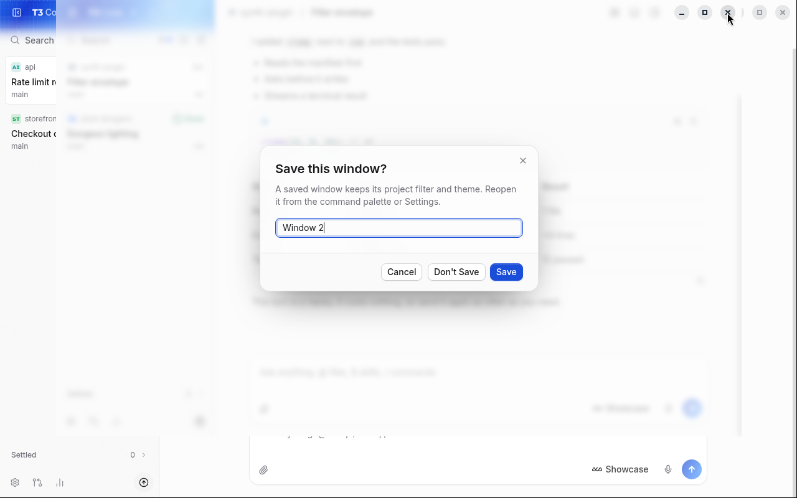 |
| Mini Mode | 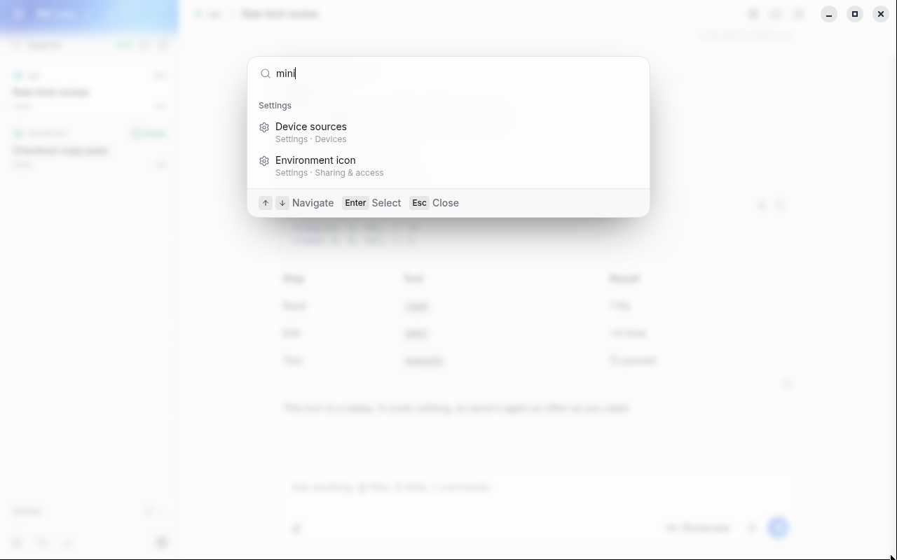 | 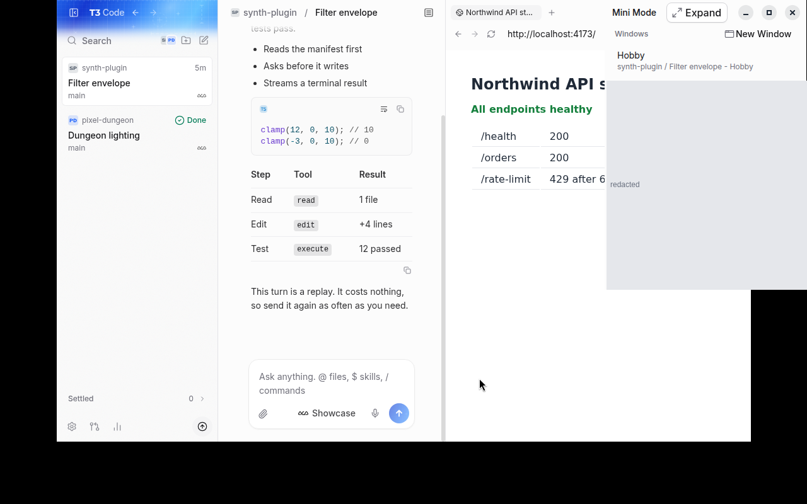 |
| Browser preview | 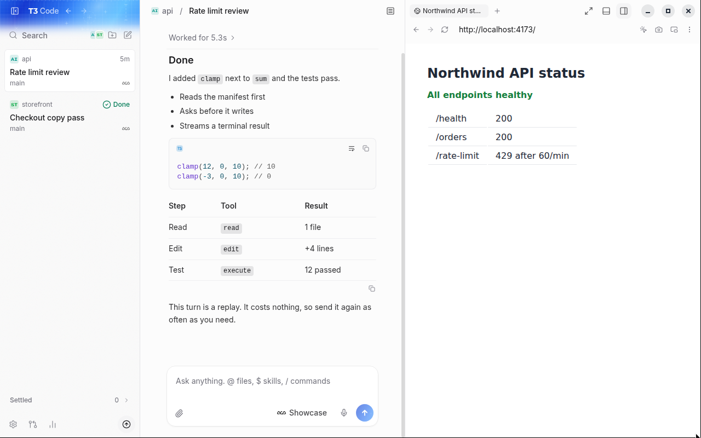 | 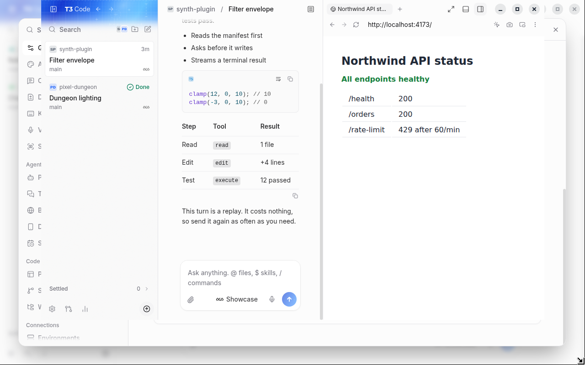 |

Recordings start after the app has loaded and are shown as GIF previews; click one for the H.264 MP4. The Mini Mode recording paints the usage area out on every frame.

| Case | Before | After |
| --- | --- | --- |
| Open a new window and filter it | [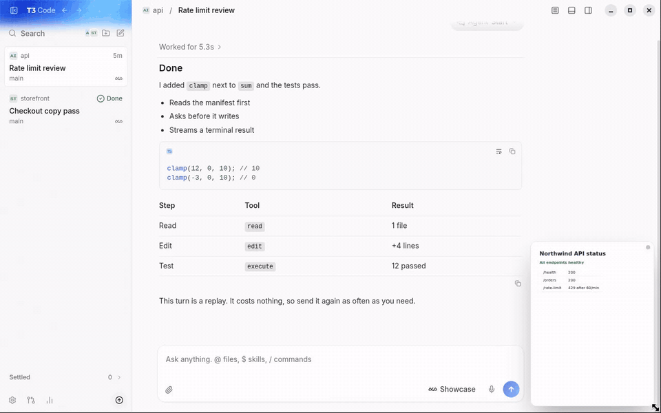](https://raw.githubusercontent.com/Na0s/t3code/pr-evidence/v2/multiwindow/video/before-new-window.mp4) | [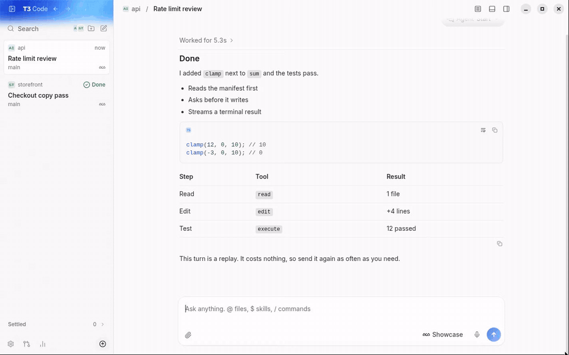](https://raw.githubusercontent.com/Na0s/t3code/pr-evidence/v2/multiwindow/video/after-new-window.mp4) |
| Close an unsaved window | [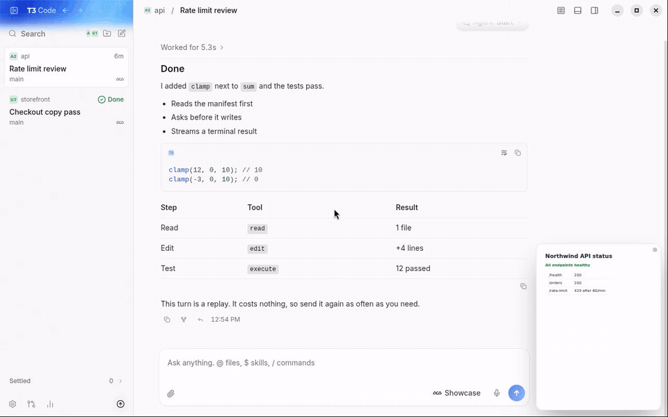](https://raw.githubusercontent.com/Na0s/t3code/pr-evidence/v2/multiwindow/video/before-close.mp4) | [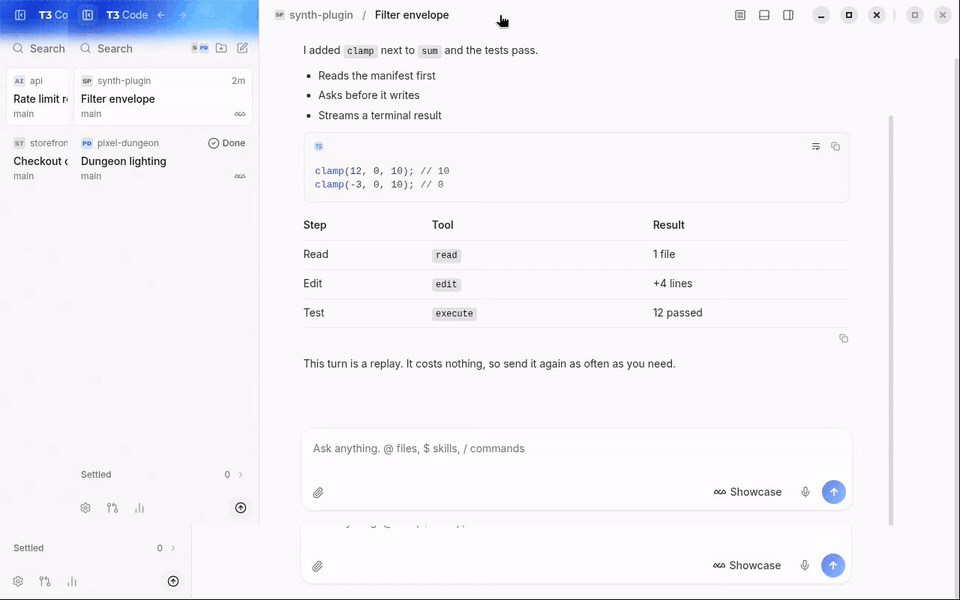](https://raw.githubusercontent.com/Na0s/t3code/pr-evidence/v2/multiwindow/video/after-close.mp4) |
| Mini Mode and back |  | [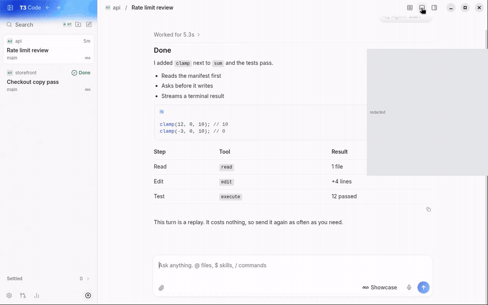](https://raw.githubusercontent.com/Na0s/t3code/pr-evidence/v2/multiwindow/video/after-mini.mp4) |

Not captured: the native **Window** menu. On Linux the app draws its own title bar (window controls overlay) and shows no menu bar, so there is nothing to capture here; its entries are covered by `DesktopApplicationMenu.test.ts`. macOS and Windows were not run.
