## Evidence

Steps: Create a plain `northwind/` folder (not a repository) holding the `storefront`, `api` and `dev-setup` git repositories and a non-git `copy/` folder, and add it as a project. In the first scenario, leave uncommitted edits in `storefront` and `api`, open a thread's diff panel and turn the umbrella on from its prompt. In the second, also add `northwind/api` as its own project with a thread, turn the umbrella on in **Settings → Projects → northwind**, then check the sidebar and search the command palette for `umbrella`. In the third, turn the umbrella on, start a worktree thread whose replayed turn waits on a question, append a line to each member's `README.md` in the thread's worktree while it waits, answer it, and then **Edit from here → Revert files too**.

Environment for every capture: Linux (WSL2), web client in e2e's Chromium at 1280×800, light theme, fresh synthetic data (the scenario T3 home is recreated per run; project folders and worktrees under the system temp directory), dev replay provider. Each scenario ran on both commits with `vp run scenarios:prove scripts/scenarios/<file> --base 7d32075e37 --head fbe013733f`.

Proven: all three scenarios fail on base and pass on head. On base the plain folder has no diff, no umbrella setting or grouping, and `--worktree` returns no thread. On head the diff panel shows `api` and `storefront` tabs and no `dev-setup` tab, the `api` thread reads `northwind · api`, and the turn diff lists both members. **Revert files too** removed the appended line from both member worktrees, and the original `storefront/README.md` stayed unchanged.

| Capture | Before — [7d32075e37](https://github.com/pingdotgg/t3code/commit/7d32075e3757ded707914e2450c3e392a9665765) | After — [fbe013733f](https://github.com/Na0s/t3code/commit/fbe013733f5c1ccd83e04b430c8b31b416a759b6) |
| --- | --- | --- |
| Diff panel on a plain folder |  | 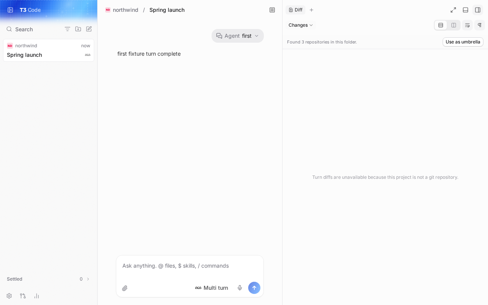 |
| Opt-in confirmation | No prompt on base, so there is nothing to confirm (see the row above). | 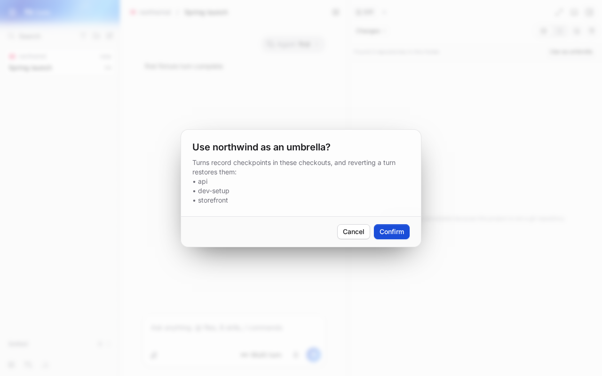 |
| Member changes |  | 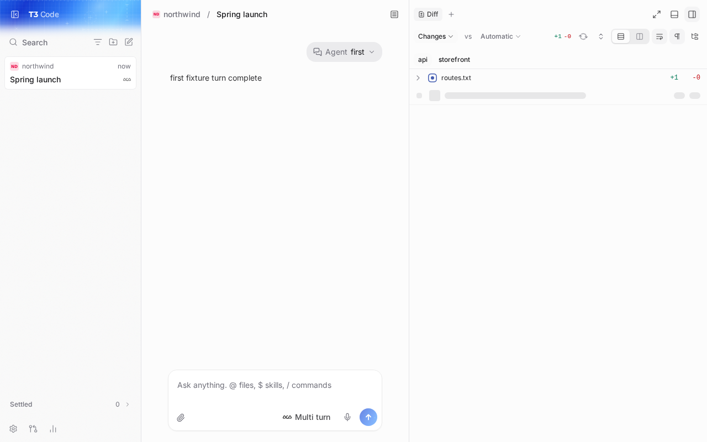 |
| Sidebar before opting in (control) |  |  |
| Settings → Projects → northwind | 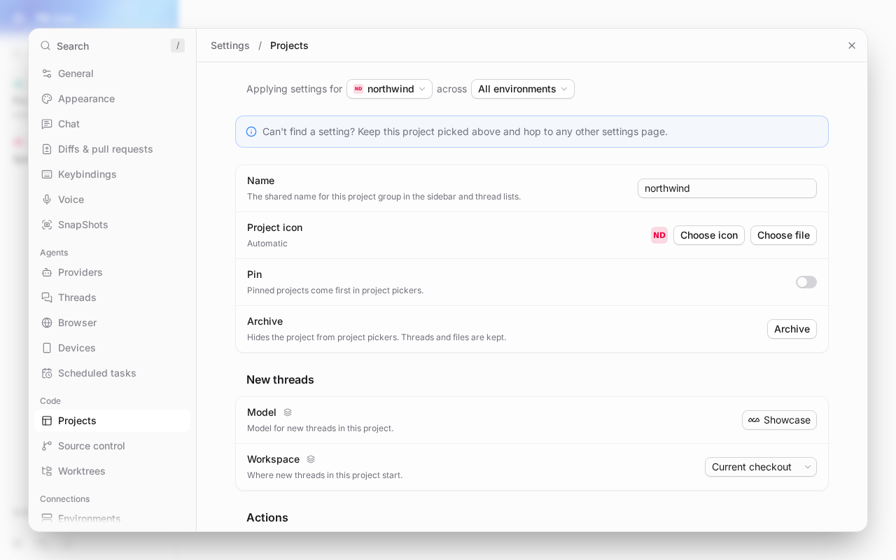 | 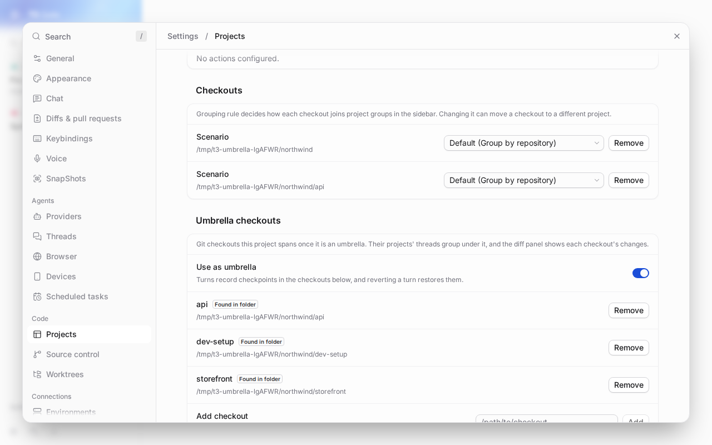 |
| Sidebar after opting in | 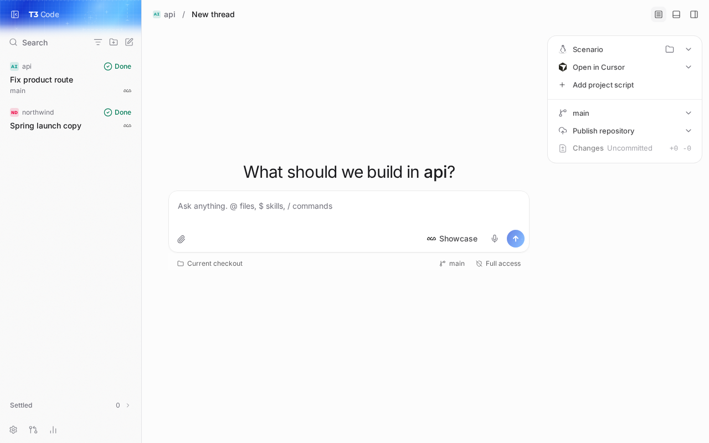 | 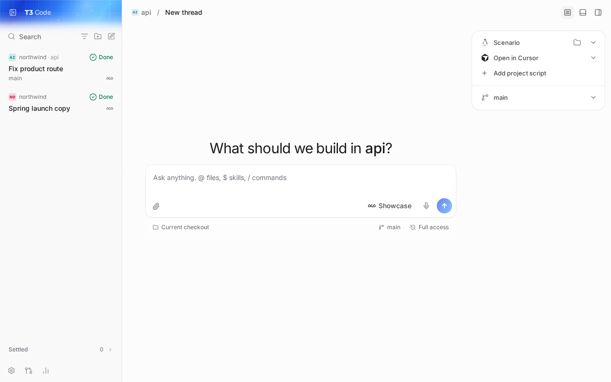 |
| Command palette, `umbrella` | 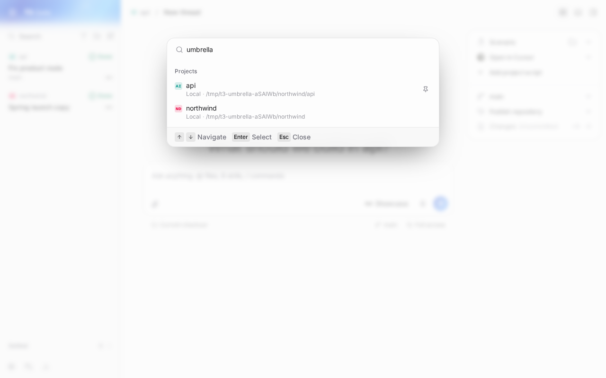 | 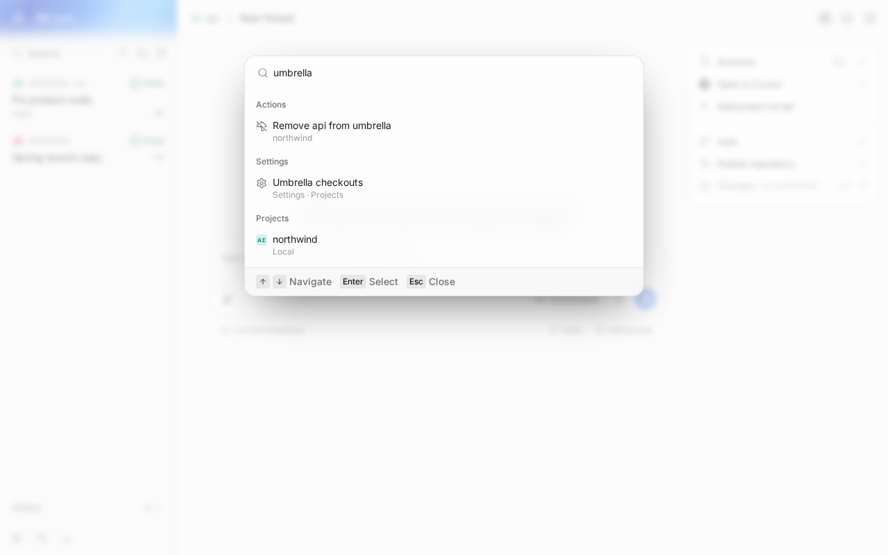 |
| Worktree turn editing two members | 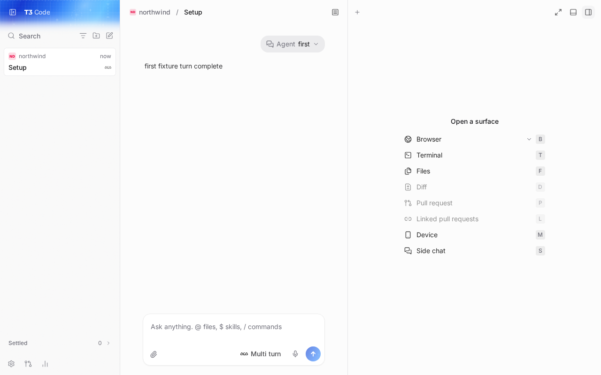 | 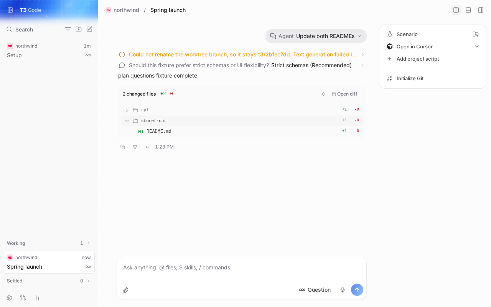 |
| Edit from here | No worktree thread on base. | 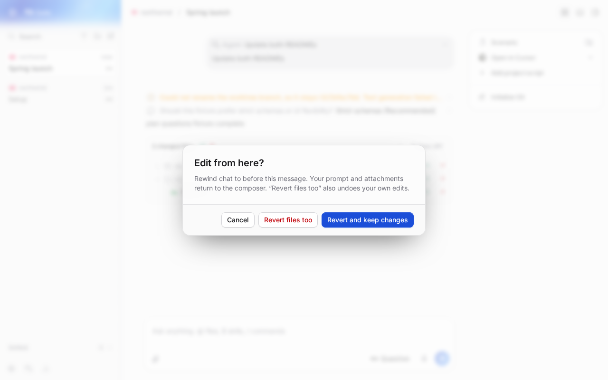 |
| After Revert files too | No worktree thread on base. | 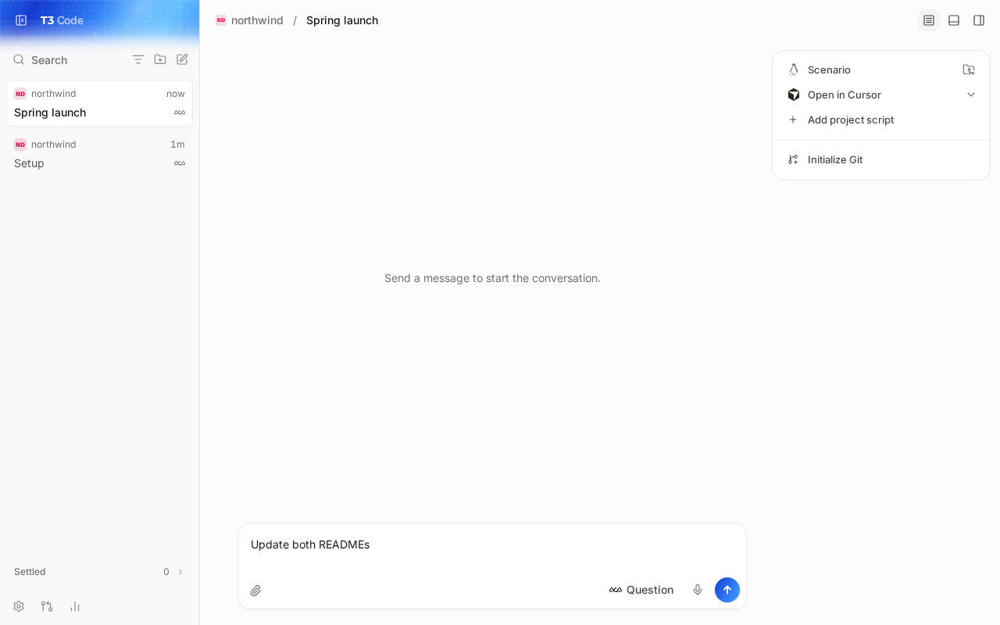 |

Recordings are e2e's full test videos, shown as GIF previews; click one for the H.264 MP4. The first seconds are blank while the app starts and signs in.

| Case | Before | After |
| --- | --- | --- |
| Diff panel and opt-in |  |  |
| Settings, sidebar and palette |  |  |
| Worktree turn and Revert files too |  |  |

Scenario sources, one test each; each depends on the repository's `scripts/scenarios/t3.ts`:
- [umbrella-diff-panel-shows-member-changes.e2e.ts](https://raw.githubusercontent.com/Na0s/t3code/pr-evidence/v2/umbrella/scenarios/umbrella-diff-panel-shows-member-changes.e2e.ts)
- [umbrella-folds-member-projects.e2e.ts](https://raw.githubusercontent.com/Na0s/t3code/pr-evidence/v2/umbrella/scenarios/umbrella-folds-member-projects.e2e.ts)
- [umbrella-worktree-reverts-member-files.e2e.ts](https://raw.githubusercontent.com/Na0s/t3code/pr-evidence/v2/umbrella/scenarios/umbrella-worktree-reverts-member-files.e2e.ts)

The replay agent never writes files, so the third scenario makes the edits itself while the turn waits on its question, then checks the member files on disk after the revert. The "Could not rename the worktree branch" notice appears because no text-generation model is configured in the scenario.

Not in these scenarios: the sidebar folder menu ("Add to umbrella" and "Remove api from umbrella (northwind)"). It appears only when the sidebar is grouped by project, and these scenarios use the default list. The composer's worktree option for a plain-folder umbrella isn't covered either. Both are in the earlier desktop captures: [folder menu](https://raw.githubusercontent.com/Na0s/t3code/pr-evidence/compare/umbrella-2-folder-menu.png), [composer](https://raw.githubusercontent.com/Na0s/t3code/pr-evidence/compare/umbrella-5-composer-workspace.png).
